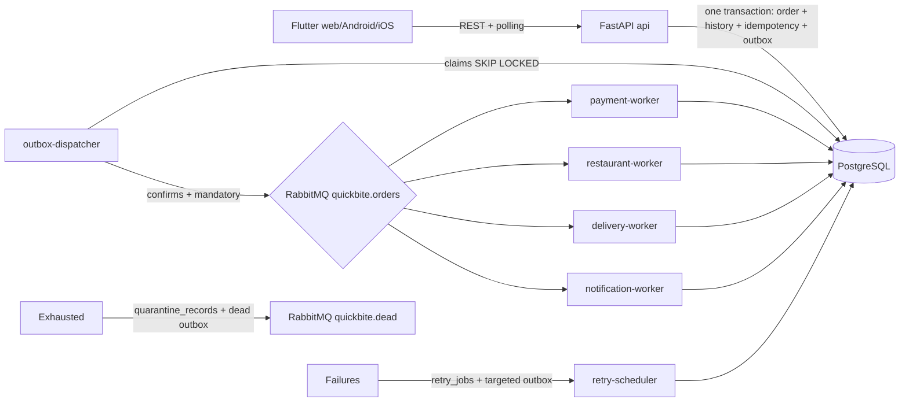

# QuickBite architecture and event flow

Key properties:

- API acceptance ends at the database commit (202 + `Location`); workers run
  asynchronously. Broker downtime never invalidates a committed order: the
  outbox waits for recovery.
- The dispatcher publishes with confirms and `mandatory=True`, marking rows
  sent only after confirmation with no unroutable return. A crash between
  publish and mark-sent creates duplicates that consumers deduplicate via
  `processed_events` (at-least-once delivery, single committed effects).
- Each consumer validates, locks the order row, checks
  `(consumer_name, event_id)`, checks state/version, then commits the
  transition + effect rows + child outbox events atomically before acking.
- Transient failures roll back, then atomically persist a `retry_jobs` row
  plus a scheduled targeted outbox row (default exchange, failing queue as
  routing key), then ack. If that transaction fails, the message stays
  unacked. Exhaustion writes a quarantine record + dead-letter outbox row and
  a terminal transition (`PAYMENT_FAILED` / `FAILED`; notifications keep
  order status), then acks.
- The Flutter client never touches the broker or database; it polls the API
  (~2 s) and retries checkout timeouts with the same idempotency key.
